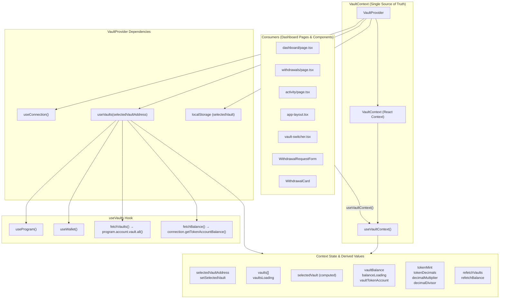
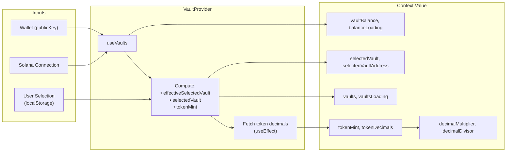
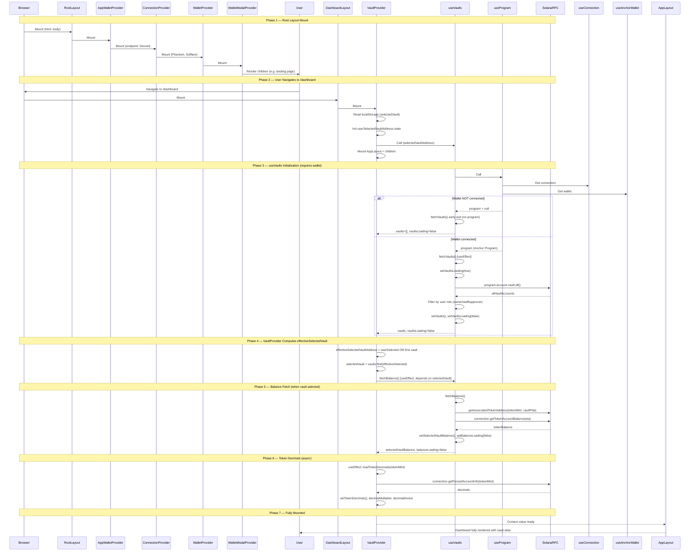
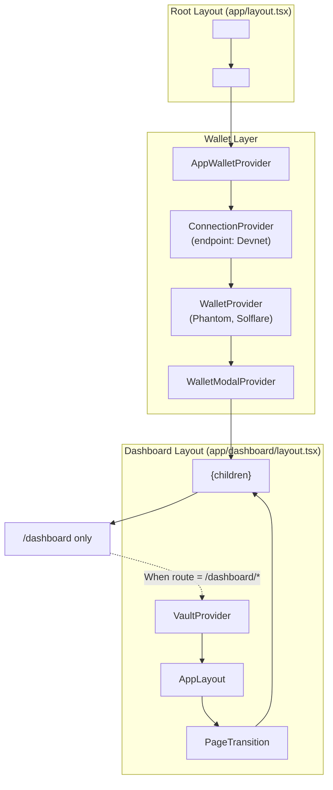

# SME Vault — Architecture Diagrams

## 1. Vault Context Architecture

This diagram shows the structure of `VaultContext`, its dependencies, and how data flows through the vault layer.

### Vault Context Data Flow (Simplified)

---

## 2. State Management: App Mount → Fully Mounted

This diagram shows the sequence of initialization from when the app mounts until the dashboard is fully loaded and ready.

### Provider Hierarchy (Component Tree)

### State Readiness Checklist

| State | Depends On | When Ready |
|-------|------------|------------|
| `connection` | `ConnectionProvider` | Immediately on mount |
| `wallet` / `publicKey` | User connects wallet | When user clicks "Connect" |
| `program` | `connection` + `wallet` | When wallet connected |
| `vaults` | `program` + `publicKey` | After `program.account.vault.all()` |
| `effectiveSelectedVaultAddress` | `vaults` + `localStorage` | After vaults loaded |
| `selectedVault` | `vaults` + `effectiveSelectedVaultAddress` | Derived, immediate |
| `vaultBalance` | `connection` + `selectedVault` + `vaults` | After `getTokenAccountBalance()` |
| `tokenDecimals` | `connection` + `tokenMint` | After `getParsedAccountInfo()` |
| `decimalMultiplier` / `decimalDivisor` | `tokenDecimals` | Derived, immediate |

---

## Summary

- **VaultContext** is the single source of truth for vault selection, vault list, selected vault data, balance, and token decimals. It wraps `useVaults` and adds selection logic and persistence.
- **App mount flow**: Root → Wallet providers → (on /dashboard) → VaultProvider → useVaults → useProgram. Vault data loads only after the wallet is connected; balance and token decimals load after a vault is selected.
