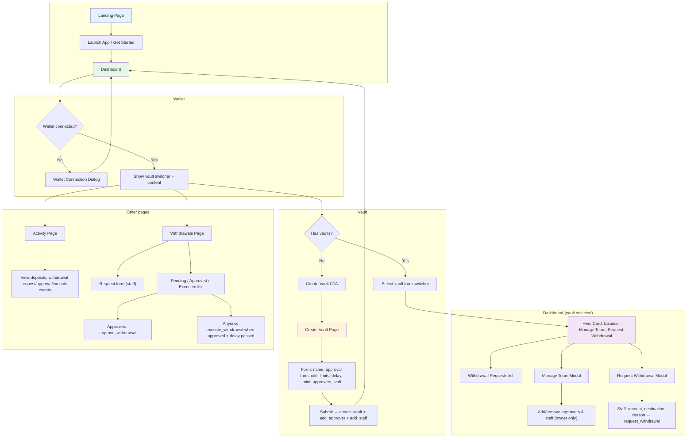
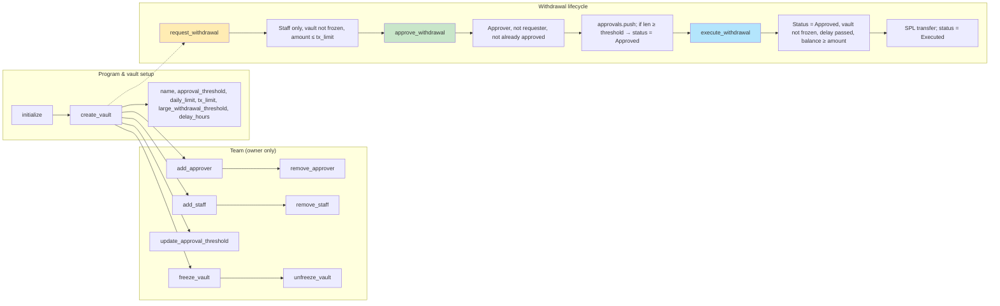
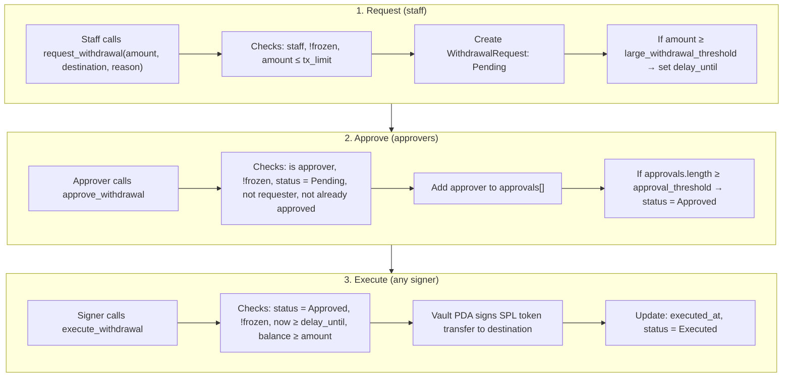

# SME Vault — User Flow & Smart Contract Diagrams

## 1. App User Flow

---

## 2. Smart Contract (Program) Flow

---

## 3. Withdrawal Request → Approve → Execute (detailed)

---

## 4. App ↔ Contract Mapping

| App action / screen | Program instruction(s) |
|--------------------|-------------------------|
| Create Vault (form submit) | `create_vault`, then `add_approver` / `add_staff` per member |
| Manage Team (add/remove) | `add_approver`, `remove_approver`, `add_staff`, `remove_staff` |
| Update approval threshold | `update_approval_threshold` |
| Request Withdrawal modal | `request_withdrawal` |
| Approve button on a request | `approve_withdrawal` |
| Execute button on approved request | `execute_withdrawal` |
| Freeze / unfreeze (if in UI) | `freeze_vault`, `unfreeze_vault` |
| Deposits | No instruction — user sends SPL tokens to vault’s ATA |

---

## 5. Roles

| Role | How assigned | Can do |
|------|----------------|--------|
| **Owner** | Creator of vault (signer of `create_vault`) | Add/remove approvers and staff, update approval threshold, freeze/unfreeze |
| **Approver** | Added via `add_approver` | `approve_withdrawal` (cannot approve own request) |
| **Staff** | Added via `add_staff` | `request_withdrawal` |

Execution of an approved withdrawal is permissionless: any signer can call `execute_withdrawal` once the request is Approved and the delay (if any) has passed.
